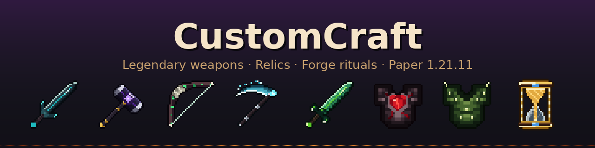
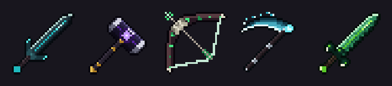
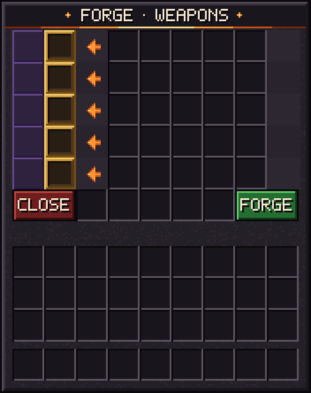
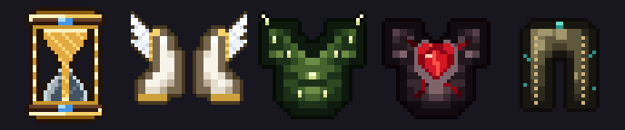
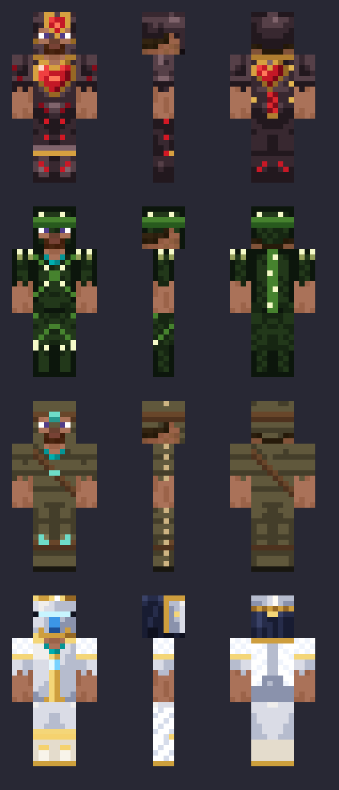
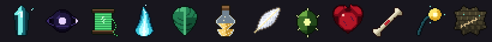

<p align="center">
  
</p>

<p align="center">
  <b>Legendary one-of-a-kind weapons, relics and forge rituals for Paper servers.</b><br>
  Every weapon has its own abilities, exists only <b>once</b> on the whole server and has to be earned:
  hunt bosses for legendary materials, then forge it in a 15-minute ritual the whole server can see.
</p>

<p align="center">
  
  
  
</p>

---

## Table of contents

- [Features](#features)
- [Installation](#installation)
- [How it works](#how-it-works)
- [Weapons](#weapons)
- [Relics](#relics)
- [Legendary materials](#legendary-materials)
- [Commands and permissions](#commands-and-permissions)
- [Configuration](#configuration)
- [Resource pack](#resource-pack)
- [Building from source](#building-from-source)
- [Limitations](#limitations)

---

## Features

- **14 legendary weapons and tools** (swords, axes, a mace, a bow, a crossbow, a spear, a trident, a pickaxe...) with original abilities on **F** and **Shift + F**, plus on-hit effects and passives
- **7 relics** for every slot: helmet, chestplate, leggings, boots and off-hand (stasis, revive, thorns,
  a growing heart, grey health, soul focus, a parrying shield)
- **Tank builds**: some abilities scale with your **max HP**, so they get stronger with Heartsteel Core
- **21 legendary materials** that drop from bosses and rare mobs or hide in structure chests, **45 % max chance**
- **Forge rituals**: forging takes 15 minutes on a crafting table and the location is revealed step by step
- **One of each**: every weapon and relic can exist only once per server
- **Forge menu** opened from any crafting table, with its own look when the resource pack is used
- **Resource pack** with animated textures, custom worn armor, particles and a themed menu
- **Fully configurable**: numbers, cooldowns, drop chances, ritual length, messages, on/off switches

<p align="center"></p>

---

## Installation

1. Download `CustomCraft.jar` from the [**latest release**](../../releases/latest) (or build it yourself, see below).
2. Put it into your server's `plugins/` folder and start the server (Paper **1.21.11**, Java **21**).
3. *(Optional, recommended)* Add the resource pack to `server.properties`. The release notes contain the exact two lines
   to copy (link + SHA1), see [Resource pack](#resource-pack). Then set `menu.resource-pack: true` in
   `plugins/CustomCraft/config.yml`.
4. Run `/forge reload` after any config change. No restart needed.

> **Updating:** just replace the jar. New weapons, relics, materials and messages are added to your existing `config.yml`
> automatically (your own changes stay). Entries you delete on purpose are remembered and not added back.
> Your forged items and running rituals are kept in `data.yml`.

---

## How it works

```
 kill bosses / loot structures  →  legendary material  →  forge at a crafting table
                                                              │
                                     15 min ritual, location revealed step by step
                                                              │
                                              weapon drops on the table (only one exists)
```

### The forge
Shift + right-click any **crafting table** with an empty hand. Pick a recipe and the materials show *needed / you have*.
Press **FORGE** when you have everything.

<p align="center"></p>

### Forge ritual
- The materials are taken and the whole server is told **which item** is being forged, but **not by whom** ("Someone").
- A boss bar shows the item, the time left and a location hint. The location is **revealed step by step**:

  | Ritual progress | Location shown |
  |---|---|
  | start | only the dimension ("somewhere in the Overworld") |
  | 33 % | an area of ±500 blocks (randomly shifted, the centre is not the table) |
  | 66 % | an area of ±100 blocks |
  | 87 % | exact coordinates |

- The item floats and spins above the table. The table can't be broken, burned, blown up or moved while the ritual runs.
- When the time is up, lightning strikes and the item **drops on the table**. Whoever picks it up owns it, so defend it.
- The timer only runs while the server is online and survives restarts.

### One of each
Every weapon and relic can exist **only once**. As soon as its ritual starts, nobody else can forge it.
If the item is destroyed as a dropped item (lava, fire, void, despawn), it can be forged again.

---

## Weapons

All abilities use **F** (swap hands) and **Shift + F**. Cooldowns show in the action bar while you hold the weapon.
On-hit effects need a **charged** hit (no spam-clicking).

### Echo Blade (sword)
| | |
|---|---|
| On hit | **Echo**: 1.5 s later the hit repeats for 40 % of its damage |
| F | **Rewind** (30 s): snap back to where you stood 4 s ago and regain the health you had then |
| Shift + F | **Resonance** (40 s): everyone you hurt in the last 10 s takes 50 % of that damage again (max 14) |

### Graviton Hammer (axe)
| | |
|---|---|
| Passive | Resistance I while held |
| On hit | **Crushing Weight**: fall onto the target for +1 damage per block fallen (max +20), and a mid-air hit cancels your fall damage like a mace. Standing above it gives +1.5 per block (max +8). Airborne targets get slammed down |
| F | **Gravity Anchor** (35 s): a 7-block field for 6 s; enemies inside are slowed and yanked back if they try to leave |
| Shift + F | **Upheaval** (45 s): lift every enemy around you and slam them down; the higher they fall, the more damage |

### Hexbow (bow)
| | |
|---|---|
| Passive | Speed I while held, witch-particle arrow trail |
| On hit | **Ricochet** (40 %): the hex jumps to the nearest other enemy for 60 % damage |
| F | **Mirror Shot** (22 s): your next arrow swaps your place with whatever it hits |
| Shift + F | **Hex Mark** (35 s): the target you look at glows and takes +30 % damage from everything for 10 s |

### Soulbinder (scythe)
| | |
|---|---|
| On hit | Collect a soul per hit, 2 per kill (max 5); heal 15 % of damage dealt |
| F | **Soul Link** (40 s): for 6 s, 50 % of the damage you take is redirected to the linked target |
| Shift + F | **Harvest** (15 s): spend all souls to heal, gain absorption and launch homing soul wisps |

### Hydra Edge (sword)
| | |
|---|---|
| On hit | **Cleave**: 40 % damage to everyone within 3 blocks of the target, heals 10 % of it |
| F | **Crescent** (12 s): spin attack, 8 damage around you, +1 heart per enemy hit |
| Shift + F | **Hydra's Wrath** (45 s): 6 s of Haste II, Strength I and Speed I; Cleave hits twice as hard |

### Butcher's Cleaver (axe)
| | |
|---|---|
| Passive | below 30 % HP you regenerate 1.5 % of your max HP per second |
| On hit | **Blunt Force**: +0.6 damage for every heart *you* are missing (max +6) |
| F | **Cleaver Toss** (8 s, costs 1 heart): the cleaver flies 18 blocks and hits for 4 + 15 % of the target's *current* health (max 16) with Slowness II. A hit heals you 5 % of your max HP and refunds half the cooldown |
| Shift + F | **Bloodrush** (70 s): pay 10 % of your current health, then regenerate **40 % of your max HP** over 10 s with Speed II; debuffs don't stick |

### Abyssal Maw (sword)
| | |
|---|---|
| On hit | **Taste**: charged hits (and the tongue) stack Taste on the target, max 3, for 6 s |
| F | **Tongue Lash** (10 s): a tongue grabs the first enemy, deals 3 + 4 % of your max HP, slows it and **yanks it to you**. Reach is 8 blocks **+0.25 per HP above 20** (max 20), so it grows with Heartsteel |
| Shift + F | **Devour** (45 s): swallow what you look at. **A player ally**: hidden and untouchable inside you for 4 s (they can sneak out). **An enemy with 3 Taste**: trapped and blinded for 2 s, then spat out far for 6 + 5 % of your max HP |

### Clawline Pick (pickaxe)
| | |
|---|---|
| Passive | Haste II while held; mined ores have a 20 % chance to drop twice (Efficiency V, Fortune III) |
| F | **Clawline** (6 s): shoot a hook at the block you look at (24 blocks) and get yanked to it, no fall damage after |
| Shift + F | **Dive** (30 s): hop up and slam down, carving a 3×3 shaft up to 8 blocks deep; landing sends a shockwave (6 damage, 4 blocks). Claims / protected regions are respected, containers are never broken |

### Silk Needle (sword)
| | |
|---|---|
| Passive | Speed I while held, very fast attacks |
| On hit | **Silk Bind**: every 3rd charged hit wraps the target in silk (Slowness IV for 1.25 s) |
| F | **Silk Dart** (8 s): throw the needle on a thread (16 blocks); it stabs the first enemy for 4 and pulls you to it, or to the block it hits |
| Shift + F | **Thread Storm** (40 s): spin in a storm of silk for 3 s, 1.5 damage to everyone within 3.5 blocks every ¼ s; you float while in the air |

### Knightfall (mace)
> **Not obtainable yet:** it's ready in the config, but `craftable: false` keeps it out of the forge and its material
> doesn't drop. Admins can hand it out with `/forge give <player> weapon:knightfall`.

Levels up with every **player kill** (counted on the item, shown in the lore and the action bar).

| Kills | Unlocks |
|---|---|
| 2 | **Wind Burst** can be added (anvil / enchanting table) |
| 4 | **F – Grappling Hook** (3 charges, then 10 s): hook a block and pull yourself to it; reach the end of the chain in time and you leap |
| 6 | **Speed II** while held |
| 8 | **Density** or **Breach** can be added |
| 10 | **Shift + F – Hammer Throw** (30 s): throw the hammer, 12 damage, and it pulls the enemy to you |

6 attack damage, 0.6 attack speed, unbreakable. An optional `CLOAK` on-hit (10 % chance to turn truly invisible for 3 s)
is in the config, commented out.

### Rimebreaker (war axe)
| | |
|---|---|
| F | **Throw / Recall** (3 s): throw the axe (30 blocks): 7 damage and a freeze. It stays stuck in the block or enemy; press **F** again to call it back, hitting and freezing everything on its way. While it's out you fight with your fists |
| Shift + F | **Frost Runic** (35 s): a wave of ice rolls 12 blocks forward, 6 damage, freezes and slows; water it crosses freezes over |

### Pinning Repeater (crossbow)
| | |
|---|---|
| Passive | Quick Charge III, Piercing II |
| F | **Pin Bolt** (20 s): your next bolt pins whatever it hits for 2 s (no walking, no jumping), a chain shows where |
| Shift + F | **Volley** (25 s): 5 bolts at once in a fan, no reload needed |

### Valkyrie's Lance (spear)
| | |
|---|---|
| Passive | +1 block reach |
| F | **Lunge** (10 s): dash forward, piercing everyone in the way for 7 damage |
| Shift + F | **Javelin** (30 s): throw the lance; it homes in on the target you look at (10 damage + glowing) and flies back |

### Trident of the Great Sea (trident)
*In memory of the King of the Great Sea.*

| | |
|---|---|
| On hit | **Tide**: +40 % damage and Slowness II on hits in water or rain (throws too) |
| F | **Tidal Surge** (3 charges, then 20 s): riptide anywhere, no water or rain needed; spinning hits deal 8 |
| Shift + F | **The Great Sea** (60 s): a tidal wave rolls out (8 blocks, 6 damage, pushback), then for 8 s Surge has no cooldown and you get Speed II, Dolphin's Grace and Conduit Power |

Loyalty III and Impaling V.

> **Max HP scaling.** Cleaver Toss, Bloodrush, Tongue Lash and Devour use your *max* health, so Heartsteel Core
> (up to +10 hearts) and Health Boost make them stronger. Example for Tongue Lash: 20 HP → 8 blocks,
> 40 HP (full Heartsteel) → 13 blocks.

---

## Relics

<p align="center"></p>

Relics only work in their own slot. You can wear one relic per slot: **helmet**, **chestplate**, **leggings**, **boots**
and **off-hand**.

| Relic | Slot | Effect |
|---|---|---|
| **Stasis Hourglass** | off-hand | Right-click: golden statue for 2.5 s. Nothing can hurt you, but you can't move or attack (120 s cooldown) |
| **Angel's Wings** | boots | When you would die, you come back with 50 % HP and 3 s of protection (600 s cooldown). Half fall damage |
| **Thorn Plate** | chestplate | Reflects 2 + 25 % of melee damage; attackers get **Grievous Wounds** (no healing for 3 s) |
| **Heartsteel Core** | chestplate | A charged hit on a player or big mob deals bonus damage and **permanently** adds max HP (up to +10 hearts, stored on the item) |
| **Soul Vessel Mask** | helmet | Charged hits fill your **Soul** (max 99). Hold **Shift** and stand still for 1.5 s to turn 33 Soul into 3 hearts. Getting hit breaks the focus; Soul is lost on death |
| **Stitchguard** | off-hand (shield) | **Parry**: raise the shield right before a hit (0.35 s window) and the hit is cancelled, then you stitch through to the attacker's back for 8 damage. **Shell**: while blocking, 3 hits from *any* side are absorbed (regrows 20 s after it cracks) |
| **Thick Hide** | leggings | 40 % of the damage you take becomes **grey health** that is lost over ~3 s (up to 50 % of your max HP). **Double-tap Shift** to shrug the grey health off so you never lose it (20 s cooldown) |

- Cooldowns and Heartsteel stacks are stored on the item itself.
- The armor relics have their own look when worn and small particle effects
  (feather wings at the ankles, a heartbeat on the chest, thorn bursts).
- Relics and weapons can't be used in a smithing table (no trims, no netherite upgrade).

<p align="center"></p>

---

## Legendary materials

<p align="center"></p>

Every weapon and relic needs one legendary material. **Nothing is guaranteed**: the best chance is 45 %.

| Material | Where to find it | Used for |
|---|---|---|
| Resonant Shard | Warden 35 % · Ancient City chests 3 % | Echo Blade |
| Graviton Core | Breeze 3 % · Ominous trial vaults 8 % | Graviton Hammer |
| Hexed Thread | Evoker 8 % · Witch 2 % | Hexbow |
| Soul Ember | Wither 40 % · Wither Skeleton in Soul Sand Valley 2 % | Soulbinder |
| Hydra Scale | Elder Guardian 30 % | Hydra Edge |
| Chrono Sand | Desert Pyramid chests 6 % · Ancient City chests 2 % | Stasis Hourglass |
| Seraph Feather | Ender Dragon 45 % · Phantom above Y 200, 2 % | Angel's Wings |
| Thornheart Seed | Jungle Temple chests 8 % · Ravager 4 % | Thorn Plate |
| Crimson Heart | Wither 25 % · Piglin Brute 3 % | Heartsteel Core |
| Ravenous Marrow | Zoglin 6 % · Hoglin 2 % · Bastion hoglin stable chests 6 % | Butcher's Cleaver |
| Abyssal Lure | Drowned 1 % · big Underwater Ruin chests 5 % · Shipwreck treasure 4 % | Abyssal Maw |
| Behemoth Hide | Warden 20 % · Woodland Mansion chests 6 % | Thick Hide |
| Pale Fragment | Stronghold library chests 8 % · Stronghold corridor chests 3 % · Enderman 0.5 % | Soul Vessel Mask |
| Carapace Shard | Shulker 3 % · End City chests 5 % | Stitchguard |
| Deepsteel Claw | Dungeon chests 6 % · Trial Chamber corridor chests 3 % | Clawline Pick |
| Weaver's Silk | Cave Spider 2 % · Spider 1 % · Mineshaft chests 4 % | Silk Needle |
| Fallen Crest | Vindicator 3 % · Bastion treasure chests 6 % *(off until Knightfall is forgeable)* | Knightfall |
| Rime Core | Stray 2 % · Igloo chests 12 % | Rimebreaker |
| Hunter's Bolt | Pillager 2 % · Pillager Outpost chests 6 % | Pinning Repeater |
| Valkyrie Plume | Vex 2 % · Village weaponsmith chests 4 % | Valkyrie's Lance |
| Sea King's Doubloon | Buried treasure 8 % · Guardian 1 % | Trident of the Great Sea |

- Mob drops only count when a **player** kills the mob (no farms). Looting helps a little, but the 45 % cap stays.
- The material drops on the ground, glowing, and can't burn, blow up or despawn.
  The **Ender Dragon**'s drop rises out of the dragon and spirals down onto the egg pillar.
- Every find is announced to the server.
- Materials can't be placed, eaten, traded, brewed, smelted or used in vanilla crafting.

---

## Commands and permissions

| Command | Permission | Description |
|---|---|---|
| shift + right-click a crafting table | `customcraft.use` (everyone) | open the forge |
| `/forge` | everyone | tells you how to open the forge |
| `/forge status` | `customcraft.admin` | which weapons and relics exist or are being forged (with real names) |
| `/forge give <player> <weapon:id\|relic:id\|material:id> [amount]` | `customcraft.admin` | give an item (ignores uniqueness) |
| `/forge release <id>` | `customcraft.admin` | make a weapon or relic forgeable again (stops its ritual) |
| `/forge finish <id>` | `customcraft.admin` | finish a running ritual right now |
| `/forge reload` | `customcraft.admin` | reload `config.yml` |
| | `customcraft.nocooldown` | abilities and relics without cooldowns (for testing) |

Aliases: `/recipes`, `/recepty`.

---

## Configuration

Everything lives in `plugins/CustomCraft/config.yml` and is documented inside the file. The most useful parts:

### Switch items on and off
```yaml
craftable:
  weapons:
    echo_blade: true
    hex_bow: false      # gone from the forge; existing Hexbows keep working
  materials:
    soul_ember: false   # stops dropping
```

### Ritual
```yaml
ritual:
  duration-minutes: 15
  bossbar: ALL            # ALL, NEARBY or NONE
  show-player: false      # hide who is forging
  location-reveal:
    stages:
      - { at-percent: 0,  radius: -1 }    # only the dimension
      - { at-percent: 33, radius: 500 }
      - { at-percent: 66, radius: 100 }
      - { at-percent: 87, radius: 0 }     # exact coordinates
```

### Abilities and balance
```yaml
ability-settings:
  damage-players: true
  pvp-multiplier: 1.0     # ability damage against players
  disabled-worlds: []
```
Every ability, relic and drop has its own numbers (damage, radius, cooldown, chance...) in its section.

### Making your own items
Weapons, relics and materials are defined in the config, so you can add your own and combine the existing ability types:

```yaml
weapons:
  my_weapon:
    material: DIAMOND_SWORD
    name: "&cMy Weapon"
    custom-model-data: 2001
    attack-damage: 9
    abilities:
      on-hit:
        - { type: LIFESTEAL, percent: 20, description: "Heals 20% of damage dealt" }
      active:
        anchor:
          type: GRAVITY_ANCHOR
          name: "&5Anchor"
          trigger: SWAP          # SWAP = F, SHIFT_SWAP = Shift + F
          cooldown: 30
          radius: 6
    forge:
      - { item: DIAMOND_SWORD, amount: 1 }
      - { item: "material:hydra_scale", amount: 1 }
```

| | Types |
|---|---|
| Active abilities | `REWIND`, `RESONANCE`, `GRAVITY_ANCHOR`, `UPHEAVAL`, `MIRROR_SHOT`, `HEX_MARK`, `SOUL_LINK`, `HARVEST`, `CRESCENT`, `FRENZY`, `CLEAVER_TOSS`, `BLOODRUSH`, `TONGUE_LASH`, `DEVOUR`, `CLAWLINE`, `DIVE`, `SILK_DART`, `THREAD_STORM`, `GRAPPLE`, `HAMMER_THROW`, `AXE_THROW`, `FROST_WAVE`, `PIN_BOLT`, `VOLLEY`, `LUNGE`, `JAVELIN`, `TIDAL_SURGE`, `GREAT_TIDE` (options: `charges`, `unlock-kills`) |
| On-hit effects | `ECHO`, `CRUSH`, `RICOCHET`, `SOUL`, `LIFESTEAL`, `CLEAVE`, `BLUNT_FORCE`, `TASTE`, `SILK_BIND`, `TIDE`, `CLOAK` |
| Relic types | `STASIS`, `REVIVE`, `THORNS`, `HEARTSTEEL`, `THICK_HIDE`, `SOUL_VESSEL`, `STITCHGUARD` (slots: `OFFHAND`, `HEAD`, `CHEST`, `LEGS`, `FEET`) |
| Material drops | `{ mob: WARDEN, chance: 35 }`, `{ loot-table: chests/ancient_city, chance: 3 }`, optional `biomes`, `min-y`, `max-y` |

---

## Resource pack

The plugin works without it, but the pack is what makes it look legendary:

- animated 32×32 textures for all weapons, relics and materials
- the Hexbow's own draw animation
- worn looks for Thorn Plate, Heartsteel and Angel's Wings
- a forge-themed menu (stone panel, gold result slots, ember arrows, FORGE / CLOSE buttons)

The pack's source is in [`resourcepack/`](resourcepack). GitHub Actions zips it and attaches it to every release.

**Setup on a server**
1. Copy the two lines from the release notes into `server.properties`:
   ```properties
   resource-pack=https://github.com/<owner>/<repo>/releases/latest/download/CustomCraft-pack.zip
   resource-pack-sha1=<sha1 from the release notes>
   ```
   This link never changes, it always points to the newest release. Only update the SHA1 when the pack itself changed (the release notes always show the current one).
   Optionally add `require-resource-pack=true`.
2. Set `menu.resource-pack: true` in the plugin config and run `/forge reload`.

**Local testing:** drop the zip into `.minecraft/resourcepacks`, enable it in the game, and set `menu.resource-pack: true`.

Custom model data used by the pack: weapons `1001-1004`, `1006-1015`, `1205`, relics `1201-1204`, `1206-1208`, materials `1301-1321`, menu icons `9000-9021`.

---

## Building from source

Requires **Java 21** and **Maven**.

```bash
mvn clean package
```

The plugin ends up in `target/CustomCraft.jar`.

### Automatic releases (GitHub Actions)
[`.github/workflows/build.yml`](.github/workflows/build.yml) builds the plugin and zips the resource pack on every push:

| You do | You get |
|---|---|
| push to `main` / `master` | a new release `v<version>-build.<n>` marked **Latest**, with `CustomCraft.jar` + `CustomCraft-pack.zip` |
| push a tag like `v1.9.0` (`git tag v1.9.0 && git push origin v1.9.0`) | a permanent release **v1.9.0** with both files and a changelog |
| any build | both files are also attached to the workflow run as an artifact |

The release notes include the `server.properties` lines with the current pack SHA1.
If a release fails with a permission error, enable *Settings → Actions → General → Workflow permissions → Read and write*.

### Project layout

| File | What it does |
|---|---|
| `CustomCraft.java` | plugin entry point, messages |
| `ItemManager.java` | loads weapons, relics and materials from the config and builds the items |
| `MenuManager.java` | the forge menu |
| `RitualManager.java` | forge rituals, uniqueness, boss bar, location reveal |
| `ForgeData.java` | `data.yml`: who owns what, running rituals |
| `AbilityManager.java` / `WeaponAbilities.java` | weapon abilities, cooldowns, action bar HUD |
| `RelicManager.java` / `Relic.java` | relic effects |
| `LootManager.java` | legendary material drops, chest and vault loot |
| `RecipesCommand.java` | `/forge` command |
| `resourcepack/` | resource pack source (zipped by GitHub Actions) |

---

## Limitations

- A plugin can't add buttons to the vanilla crafting table window, so the forge is its own menu (shift + right-click).
- Worn armor can only change its texture, not its 3D shape, without client mods.
- A forge recipe has room for 5 different ingredients.
